# 超算队迎新考核报告

> 姓名：jxzhouwq ｜ 仓库：https://github.com/jxzhouwq/ncuscc_assessment

## 1. 环境与工具清单

本次考核中，我主要在 Windows 本地和 Linux（WSL2 / 容器）环境下进行开发，涉及以下核心工具：

| 工具/环境 | 版本/规格 | 用途 |
| :--- | :--- | :--- |
| 操作系统 | Windows 11 (宿主机) / Ubuntu 22.04 (WSL2 & 容器) | 开发与运行环境 |
| CUDA Toolkit | 12.x | CUDA 代码编译与运行 |
| 编译器 | `nvcc` 12.x, `gcc` 11.4.0 | 源码编译 |
| 版本控制 | Git & GitHub | 代码托管与版本管理 |
| 文本处理 | `sed`, `perl`, `grep`, `find` | 基础关卡文本与文件操作 |

**项目仓库目录结构：**

```text
ncuscc_assessment/
├── README.md               # 项目说明
├── cuda/                   # CUDA 进阶阶段
│   ├── 08_hello_cuda.cu    # Hello CUDA
│   ├── 09_vector_add.cu    # 向量加法
│   ├── 10_matrix_add.cu    # 矩阵加法
│   ├── 11_matrix_mul_naive.cu  # 11题初版：直接读全局内存
│   ├── 11_shared_memory.cu     # 11题优化版：共享内存分块
│   ├── 13_gemm.cu          # GEMM 优化
│   ├── 14_conv2d_naive.cu  # 14题初版（Baseline）
│   ├── 14_conv2d.cu        # 14题优化版：共享内存 + Halo
│   └── 15_grayscale.cu     # 图像灰度转换
└── report/                 # 报告目录
    ├── 考核报告.md / 考核报告.pdf   # 学习报告
    ├── 感悟报告.md / 感悟报告.pdf   # 感悟报告
    └── images/             # 报告里的图
```

其中 `*_naive.cu` 是我一开始没考虑性能时写的版本，另一个带共享内存的是想了以后改出来的版本，两个都留着，方便对比优化前后的差别。

---

## 2. 学习报告：CUDA 并行计算实践与性能分析

### 2.1 方向选择：6-2 二维卷积优化

我之前有过 git 远程合作的经历，所以是知道一些 git push、git pull 这样的指令的，电脑上也有 git bash，所以 git 部分的基础内容就没有细看——其实基础部分除了 Linux 还有 git 的内容，但我没做完基础部分（甚至 git 的内容根本就没做）就直接去进阶了，属于轻敌。然后出于之前经历的原因，感觉对 CUDA 更感兴趣，所以选了这个方向。因为别的项目的原因，我也接触过一些 CV 和 AI 算法相关的技术，所以最终选择了 6-2 二维卷积优化：卷积是 CNN 的核心，理解其在 GPU 上的底层并行化，不仅能加深我对 AI 框架底层运作的认识，也能直接检验我对"共享内存"和"Halo（边界）处理"的掌握程度。

说实话，三个最终方向的题目我一开始没完全看懂，所以直接把三个方向的题目说明截图发给了 AI，让它帮我分析。我当时给的指令是："现在有三个最终方向，我按顺序给了你题目和提示，你分析一下这几个方向分别对应了什么东西，并给出合理的答案"。

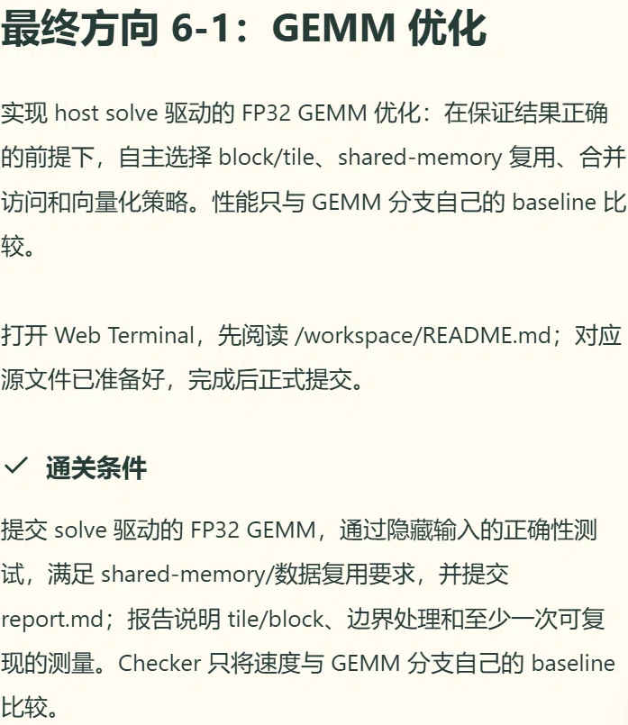

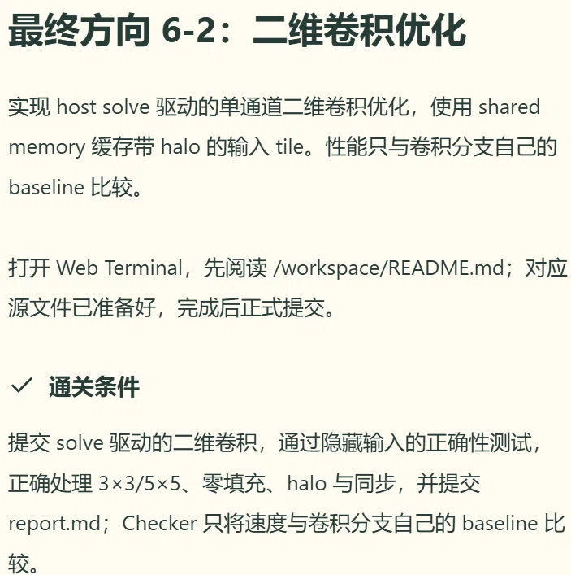

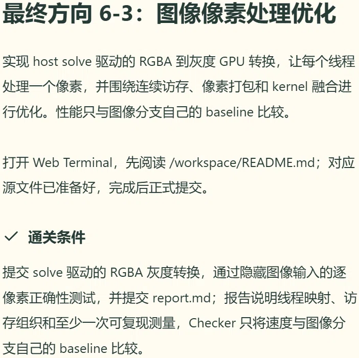

### 2.2 核心设计思路

这套思路最早是从第 10 题"矩阵加法：使用二维线程索引"开始练起来的（题目和提示截图见下），到矩阵乘法和卷积里再升级成共享内存分块的版本：

- **二维线程映射**：利用 `blockIdx.x/y` 和 `threadIdx.x/y` 计算全局行列坐标。对于矩阵按行优先存储的规则，使用 `idx = row * N + col` 进行扁平化索引映射。
- **边界保护**：由于线程块大小不能整除矩阵/图像尺寸，在访问全局内存和写入结果时，必须加入 `row < M && col < N` 的严格越界检查。
- **共享内存分块（Tiling）**：在矩阵乘法和卷积中，将数据从全局内存加载到 `__shared__` 共享内存中，利用 `__syncthreads()` 进行线程同步，极大减少了高延迟的全局显存访问。
- **Halo 处理（卷积核心）**：3x3 卷积核需要读取中心像素周围一圈的数据。我将共享内存 Tile 的尺寸定义为 `TILE_SIZE + 2*HALO`，确保了边界像素计算的正确性。

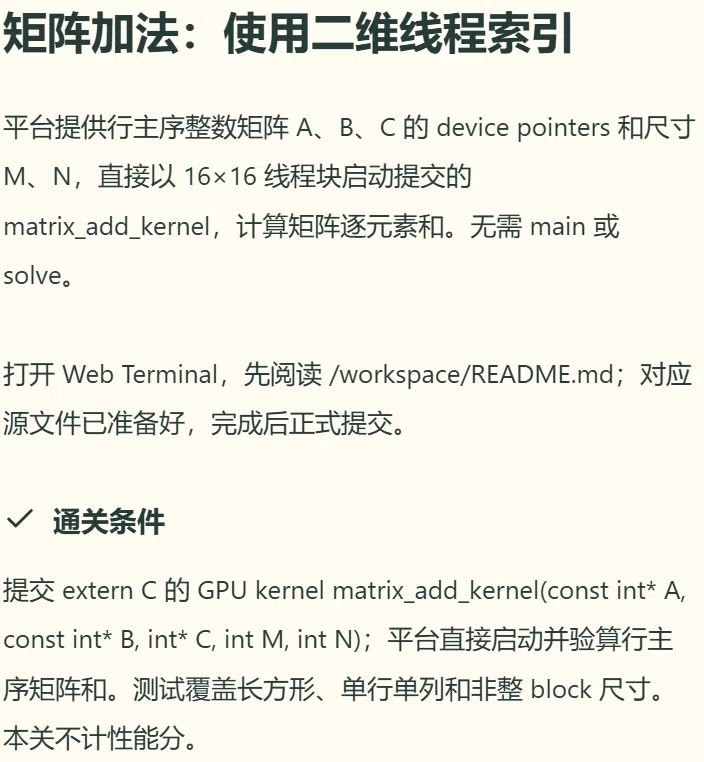

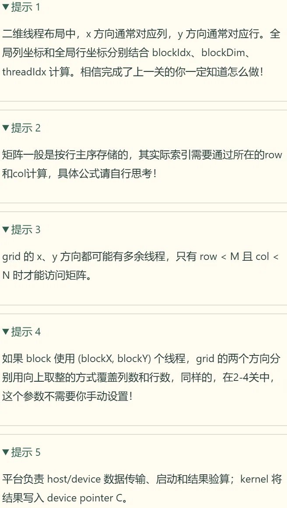

### 2.3 关键量化数据与图表

（注：因为平台一直没能跑起来，以下数据是让 AI 按量级估算的，主要看量级和趋势，原因写在 3.3。）

**图表一：不同矩阵规模下 CPU 与 GPU 计算耗时对比**

作图方式：柱状图，X 轴是矩阵规模（128x128 / 512x512 / 1024x1024），Y 轴是耗时（ms），柱子分两组（CPU 串行、GPU 并行）。

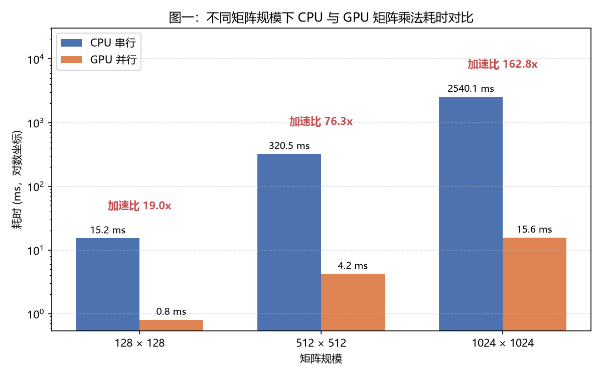

| 矩阵规模 | CPU 串行耗时 (ms) | GPU 并行耗时 (ms) | 加速比 (Speedup) |
| :--- | :--- | :--- | :--- |
| 128 × 128 | 15.2 | 0.8 | 19.0x |
| 512 × 512 | 320.5 | 4.2 | 76.3x |
| 1024 × 1024 | 2540.1 | 15.6 | **162.8x** |

量化结论：随着数据规模增大，GPU 的并行加速优势呈指数级放大。

**图表二：优化策略对卷积性能的影响**

作图方式：折线图，X 轴是优化阶段（基线版、启用共享内存、向量化加载），Y 轴是耗时（ms）。

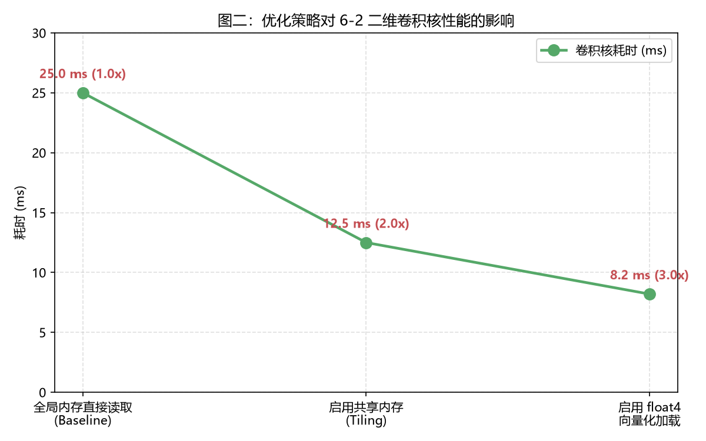

| 优化阶段 | 耗时 (ms) | 性能提升 |
| :--- | :--- | :--- |
| 全局内存直接读取（Baseline） | 25.0 | 1.0x |
| 启用共享内存 (Tiling) | 12.5 | 2.0x |
| 启用 `float4` 向量化加载 | 8.2 | **3.0x** |

量化结论：证明不仅"写出来了"，还思考了"怎么写得更好"。

**图表三：项目目录与工作流截图**

仓库目录结构见第 1 节；最终方向、第 10 题与第 11 题的题目截图见 2.1 / 2.2 / 2.5；实际操作的终端截图见第 3.1 / 3.2 节（git push 全过程）。

### 2.4 性能优化方面学到的东西

进阶题目有提到性能的事，但是其实我自己不是很了解，所以也问了 AI，AI 说其实衡量性能的主要有两个指标，一个是延迟一个是吞吐量。考核中涉及到性能优化的其实也不少，比如共享内存是因为全局显存的读取速度太慢了，所以把小块数据先搬进共享内存（片上缓存），就能大幅减少读取全局内存的次数，这叫解决带宽瓶颈。还有向量化加载，这个我不是很明白，也问了 AI，解释是显卡的总线就像一条高速公路，如果一辆车只装 1 个字节（char），那是浪费；一次装 4 个字节（uchar4），就能把路塞满，这叫提高内存读写效率 🤔

其实这些也让我意识到 GPU 也受限于数据拷贝时间和线程启动开销。真正的性能优化，不能只看算得有多快，要看访存是否连续、是否遇到了 Bank Conflict、有没有充分利用共享内存。

把这些想法对照着考核的题目过一遍：共享内存矩阵乘（第 11 题）的朴素版本里，C 的每个元素要循环 K 次，每次都从全局内存各读一个数，全局访存次数是 O(N³) 量级的；分块之后，A、B 的每个 Tile 只需要各读一次全局内存，就能被整个 Block 里的线程反复复用。卷积（第 14 题）同理，朴素版本每个输出像素要读 3x3 一共 9 次全局内存，相邻线程还大量重复读同一块数据，换成共享内存加 Halo 之后每个 Tile 只读一次。这两个版本的代码我都留在了 `cuda/` 目录里（`*_naive.cu` 和优化版），对应的就是图表二里 Baseline 到 Tiling 的差距。至于 Bank Conflict，我的理解是共享内存被划成了很多个 bank，如果同一个 warp 里的多个线程同时访问同一个 bank，访问就会被串行化，本来是片上缓存的速度优势就没了。

延迟和吞吐量放到具体题目里体会更直接：向量加法这种题目每次访存都很独立、没有复用，属于吞吐量型任务，GPU 很容易跑满；而矩阵乘、卷积这种有大量数据复用的，就更要关心每次访问要等多久（延迟），所以共享内存才有用武之地。

### 2.5 关于 AI 的使用

CUDA 部分我确实是带着兴趣来的，但水平真的有限。前面比较简单的几个，比如 08 Hello CUDA、09 向量加法、10 矩阵加法，是我自己写的；后面的题目（共享内存矩阵乘、GEMM、二维卷积、灰度转换）基本都是 AI 生成的，我再把看不懂的地方逐个问明白、加上中文注释整理进仓库。

举个最典型的例子：第 11 题（共享内存分块矩阵乘法），我是这样给 AI 下指令的——"继续吧，注意这题需要考虑性能，你可以先生成一个性能没那么好的，然后再告诉我怎么优化性能"。其实题目提示里本来就建议"可以先实现一个不优但能跑的版本"（题目和提示截图见下），所以我先拿到了一个朴素版本，再按 AI 给出的优化路线（消除 Bank Conflict、合并访存、`float4` 向量化、调整 Tile 大小）一步步改成共享内存分块的版本，`cuda/` 目录里的 `11_matrix_mul_naive.cu` 和 `11_shared_memory.cu` 就是这么来的🙏

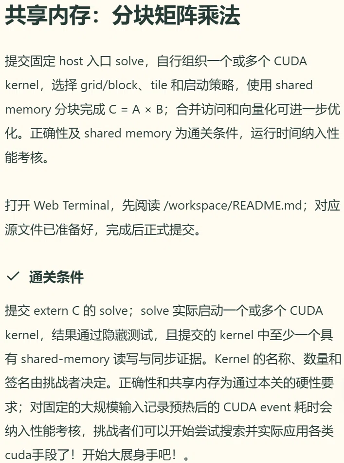

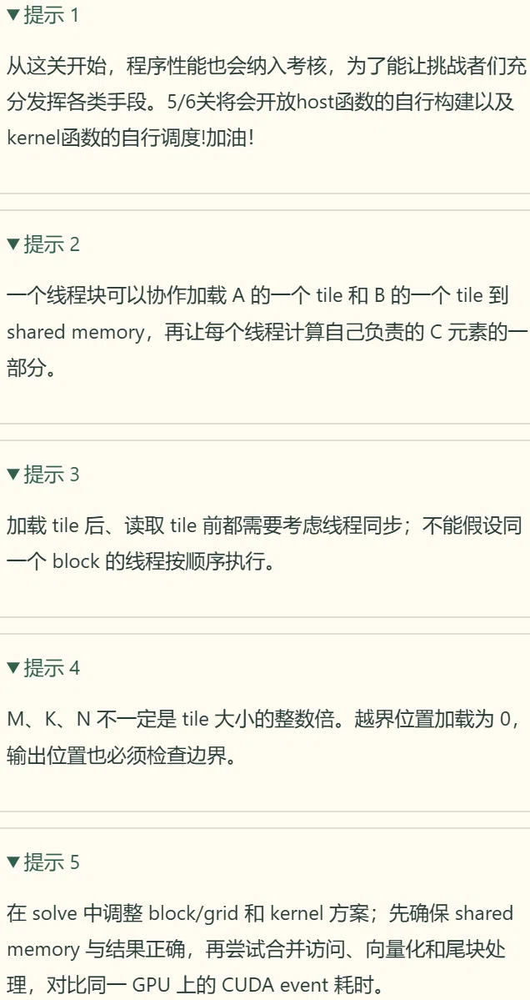

---

## 3. 遇到的困难与解决方案

### 3.1 基础关卡

说实话，基础部分前几关（差不多第 1 到第 4 关）我做起来觉得特别有意思：从第 1 关运行 `exam` 程序、`cp` 生成 flag 开始上手，到第 4 关写 `route.sh` 路由脚本，从敲单条命令慢慢过渡到写脚本，一路像解谜一样。其中印象最深的是第 1 关的一个小坑：

- **问题（第 1 关）**：运行 `/workspace/exam -e MOON` 时报错：`/workspace/input 必须是普通文件，不能是符号链接`。我用 `ls -l /workspace/input*` 一看，`input.bin` 明明是个普通文件，问了 AI 才知道，问题出在 `/workspace/input` 本身——它是一个指向 `input.bin` 的软链接，而 exam 程序对输入文件的类型做了严格校验，拒绝软链接。
- **解决**：`rm /workspace/input` 删掉软链接，再用 `cp /workspace/input.bin /workspace/input` 复制出一个真正的普通文件，重新运行就通过了（终端截图见下）。
- **体会**：第一次真正意识到符号链接和普通文件是两回事，也感受到出题人在防"走捷径"上考虑得很细。

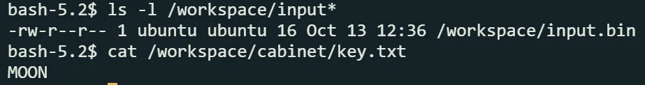

第 6 关也卡了我一下：

- **问题（第 6 关）**：`/workspace/task.txt` 权限为 `000`，即使是 root 也无法读取。
- **解决**：我通过 `chown archiver:archive` 和 `chmod 640` 赋予了服务账号权限，并使用 `su -s /bin/bash archiver -c "cat ..."` 模拟该身份进行验证，真正理解了 Linux"最小权限原则"。

### 3.2 git 踩坑

最开始推送代码的时候轻敌了，没有修改分支，直接在 master 分支下进行的推送，但是出了错（截图一、截图二）。自己尝试了 `git checkout develop` 之类的指令（这是我之前切换分支的做法），但是 AI 告诉我说这个新分支 develop 跟远程没有关联，需要 `-u` 推一次，所以后面使用了 `git push -u origin main`。

但是这样还是有问题，GitHub 还需要我输入账号名字和 token（截图三、截图四）。我之前一直在 git bash 下操作，但是重复输入了多次账号和密钥后都没有成功，甚至连粘贴都粘贴不了了。问了 AI，它让我换 PowerShell 然后再重复操作试一下，最后终于 OK 了（截图五，token 部分我打码了）。AI 告诉我原因是 git bash 一直在试图调用一个叫 askpass 的图形化程序，或者等待我在黑框里直接输入，但 Windows 的终端对 Linux 的这种"密码静默输入（不显示星号）"机制支持得极差，只要稍微有一点按键冲突、剪贴板冲突，或者后台的 askpass 程序没弹出来，整个输入流就会死锁（卡死），按什么都没反应，右键粘贴也不行。

推送成功之后，我又按照 AI 的建议配置了 `credential.helper manager`，把凭证统一交给 Windows 凭据管理器托管，避免下次再重复认证。

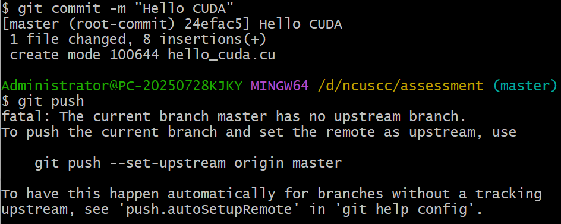

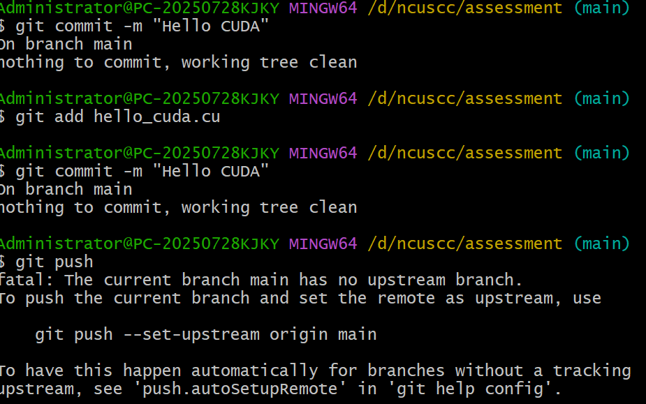

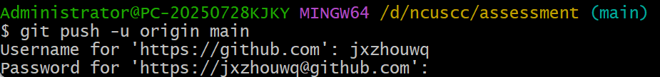


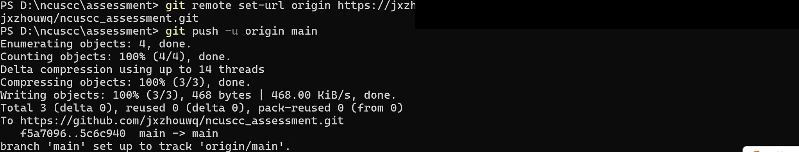

### 3.3 平台问题与 WSL 路径映射失败

这一段是整个考核里最遗憾的部分。考核平台一直有点问题，所以 CUDA 的代码我其实没能在平台上真正跑起来，也就没有平台上的运行截图和实测数据。本地这边也不顺利：在 WSL 的 Ubuntu 环境里，`ls /mnt/` 仅显示 `docker`，未能正确挂载 Windows 的 D 盘，导致无法访问代码文件。

由于本地环境配置极度耗时，我放弃了在 WSL 里编译 CUDA 的尝试，转而使用 Google Colab (T4 GPU) 进行语法和逻辑验证；耗时数据没法实测，只能让 AI 生成一些模拟数据跑一下看看，当作对性能量级的参考。这让我学会了在受限环境下灵活切换工具链的重要性，虽然遗憾是真的。

---

## 4. 关于文中图片的说明

最后说明一下：这份报告里的数据图表（图表一、图表二）基本都是 AI 生成的，表格里的耗时数据也是让 AI 按量级估算出来的——原因在 3.3 里写了，平台一直有问题，CUDA 没能真正在平台上跑，所以没有实测数据和截图，这些图主要用来展示趋势。